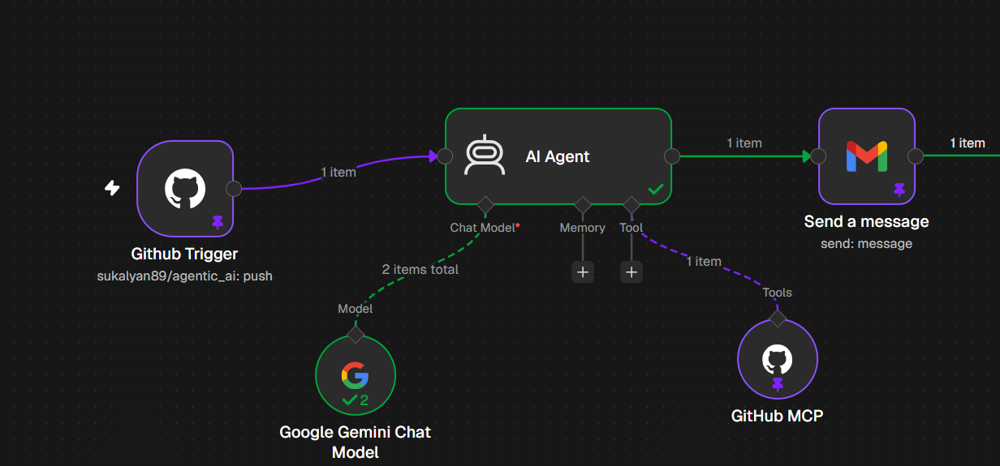

# Build a GitHub push summary email workflow in n8n





This workflow runs when someone pushes to your GitHub repo. An AI agent reviews the commits and emails you an HTML summary. The summary covers what changed, who made the change, what could happen if it's left as-is, and any potential issues.

```
GitHub Trigger  →  AI Agent  →  Gmail (send)
                    ├─ Google Gemini Chat Model
                    └─ GitHub MCP (read-only tools)
```

## Prerequisites

- An n8n instance (cloud or self-hosted) that is reachable from the internet. GitHub has to reach the webhook, so a plain `localhost` install won't work without a tunnel.
- A GitHub account with admin access to the repo. n8n needs this to register a webhook.
- A Google account for Gmail.
- A Google Gemini API key from [Google AI Studio](https://aistudio.google.com/apikey).

## Step 1: Create the workflow

1. In n8n, click **Create workflow** and name it, for example `GitHub push summary`.
2. Add the five nodes below, then connect them as shown in the diagram.

## Step 2: Add the GitHub Trigger

1. Add the **GitHub Trigger** node.
2. Create a credential. Either **OAuth2** or an **Access Token** (a personal access token with `repo` and `admin:repo_hook` scopes) works. This workflow uses OAuth2.
3. Set these fields:
   - **Authentication:** OAuth2 (or Access Token)
   - **Owner:** your GitHub username or org
   - **Repository:** the repo to watch
   - **Events:** `push`
4. Leave **Options** empty.

When you publish the workflow, n8n registers the webhook on your repo. Nothing is created on GitHub until then.

**Payload shape:** the push data arrives under a `body` field, for example `$json.body.repository.full_name` and `$json.body.commits`. Reading `$json.repository` returns empty. This tripped up the first version of this workflow.

## Step 3: Add the AI Agent

1. Add an **AI Agent** node and connect the trigger to it.
2. Set **Source for Prompt** to **Define below**.
3. Paste this into **Prompt (User Message)** and switch the field to **Expression** mode:

```
A push event was received on repository {{ $json.body.repository.full_name }}.
Branch: {{ $json.body.ref }}
Pushed by: {{ $json.body.pusher.name }} (sender: {{ $json.body.sender.login }})
Compare URL: {{ $json.body.compare }}
Head commit: {{ $json.body.head_commit.id }}
Commits:
{{ JSON.stringify($json.body.commits.map(c => ({ id: c.id, message: c.message, author: c.author.name, url: c.url, added: c.added, removed: c.removed, modified: c.modified }))) }}

Use the GitHub tools to fetch the actual diff/files of these commits and review them, then write the summary.
```

4. Open **Options**, click **Add Option**, choose **System Message** and paste this:

```
You are a senior code reviewer. When given a GitHub push event, inspect the commits and code changes using the GitHub tools, then write the summary as the BODY OF AN EMAIL, formatted as simple HTML.

Output rules:
- Output ONLY the HTML fragment. No markdown, no code fences, no <html>/<head>/<body> tags, no subject line, no preamble.
- Start with <p>Hi team,</p> and one short <p> sentence stating the repository, branch, and number of commits.
- Then use these sections, each as an <h3> heading followed by a <ul> of <li> bullets:
  <h3>Changes</h3> - one bullet per meaningful change (file/area and what changed).
  <h3>Made by</h3> - who made each change (author/pusher, branch, commit id as short 7-char hash linked to the commit URL with <a href>).
  <h3>Impact if left as-is</h3> - what may happen if these changes are left unreviewed/unmerged/unchanged (bugs, regressions, drift, deployment risk).
  <h3>Potential issues</h3> - bugs, security risks (secrets, credentials, injection), breaking changes, missing tests, bad practices, large or risky commits. Wrap the key risk in each bullet in <strong>, and start high-severity bullets with the text "WARNING:". If none are found, write a single bullet saying no issues were found.
- Finish with <p>Compare changes: <a href="COMPARE_URL">view diff</a></p> using the real compare URL, then <p>Regards,<br>n8n Code Review Agent</p>.
- Keep bullets concise and specific. Do not invent details; base everything on the actual diff. If a file's contents could not be read, say so plainly.
```

**Memory:** don't add a Simple Memory node. It needs a chat session ID, and push events don't have one, so the run fails with "No session ID found".

## Step 4: Add the Gemini model

1. Click the **Chat Model** (+) connector on the AI Agent and choose **Google Gemini Chat Model**.
2. Create a **Google Gemini (PaLM) API** credential and paste your API key.
3. Set **Model** to `models/gemini-2.5-flash`. Any current Gemini model should also work.

## Step 5: Add the GitHub MCP tool

1. Click the **Tool** (+) connector on the AI Agent and choose **GitHub MCP**.
2. Create a **GitHub OAuth2** credential. You can reuse the one from Step 2.
3. Set **Tools to Include** to **Selected**, and pick only these four:
   - `get_commit`
   - `get_file_contents`
   - `list_commits`
   - `run_secret_scanning`

**Why only these four?** Limiting the tools keeps the agent read-only, so it can't push, merge or edit anything. It also avoids a bug: with all tools enabled, Gemini rejected one tool's schema with a `400 Invalid JSON payload` error. `run_secret_scanning` may start a secret scan in the repo. Remove it if you don't want that.

## Step 6: Add the Gmail node

1. Add a **Gmail** node after the AI Agent.
2. Create a **Gmail OAuth2** credential and sign in with the sending account.
3. Set these fields:
   - **Resource:** Message
   - **Operation:** Send. Don't use "Send and Wait for Approval", because that pauses the run until someone clicks a button.
   - **To:** your recipient address
   - **Subject** (Expression mode):
     ```
     Push summary: {{ $('Github Trigger').item.json.body.repository.full_name }} ({{ $('Github Trigger').item.json.body.ref.replace("refs/heads/", "") }})
     ```
   - **Message** (Expression mode): `{{ $json.output }}`
   - **Email Type:** HTML, if your Gmail node version shows this option. The agent outputs HTML, so without it the tags may show as plain text.

## Step 7: Test it

1. Click **Execute workflow** to put the trigger in listening mode.
2. Push a small commit to the repo.
3. Check that the email arrives and that the nodes show their results.

If the email says "No repository, branch, or commit information", the expressions are reading the wrong fields. Re-check that they use `$json.body.…`.

## Step 8: Publish

1. Click **Publish** (or toggle the workflow to active).
2. The webhook is now registered on your repo and every push triggers the workflow.
3. Check **Settings → Webhooks** in your GitHub repo to confirm an n8n webhook is listed.

If you change the workflow later, publish again. Otherwise the older published version keeps running.

## Troubleshooting

| Problem | Cause and fix |
|---|---|
| Email says no repo or commit info | Expressions read `$json.repository` instead of `$json.body.repository`. |
| `No session ID found` | A memory node is attached. Remove it. |
| `400 Invalid JSON payload ... tools[0]` from Gemini | Too many GitHub MCP tools are exposed. Use the four-tool list. |
| `Parameter "Subject" is required` | The Gmail subject is empty. Set it as in Step 6. |
| Workflow never triggers | It isn't published, the repo or owner is wrong, or your n8n URL isn't public. |
| Webhook creation fails | The GitHub credential lacks admin rights on the repo. |
| Agent says it couldn't read file contents | The GitHub credential can't access the repo, or the file is binary or very large. |

## Optional customizations

- **Several recipients:** put comma-separated addresses in **To**.
- **Other events:** add `pull_request` to the trigger's events, but update the prompt, because the payload shape differs.
- **Different tone or checks:** edit the system message, for example to add "flag any change to files under `/infra`".
- **Switch the model:** swap the Gemini node for OpenAI or Anthropic. The rest stays the same.
